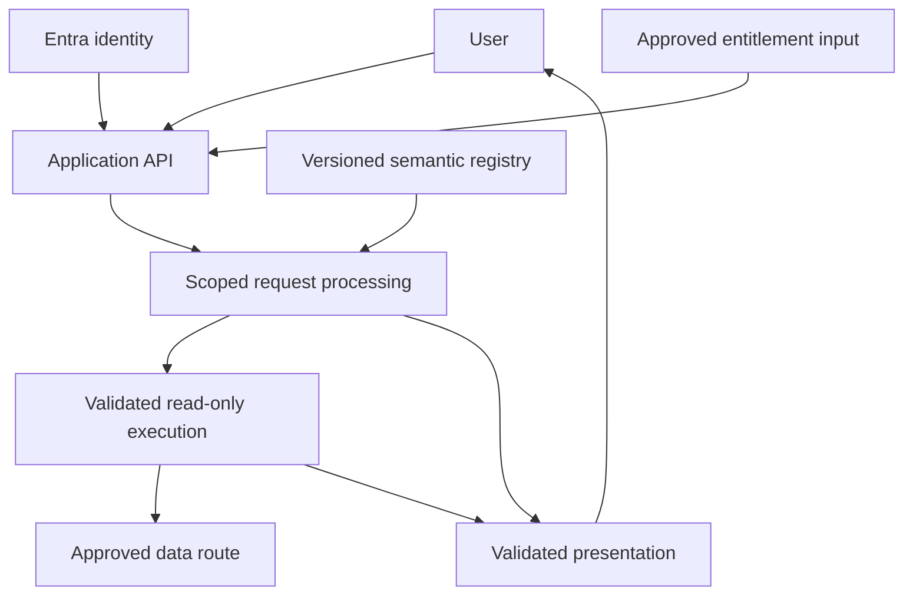
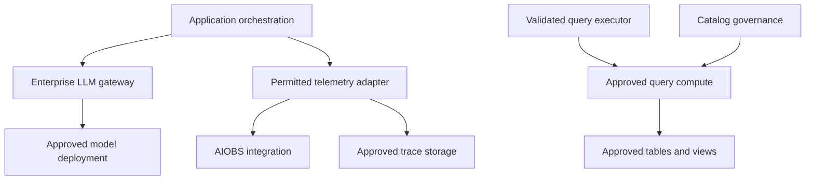

# askalpha (AskTD) — Solution architecture

**Updated:** 14 September 2026 | **Version:** 1.0 | **Status:** Reconciled working design; enterprise decisions and runtime qualification remain open

This document combines the supplied application and target-state diagrams, the leadership meeting, the latest owner-edited emails and the engineering agent's reported source review. It supersedes conflicting planning descriptions in the August handoff. It does not replace historical commit evidence or establish deployed configuration.

## 1. Delivery objective and evidence baseline

Deliver a bounded, read-only conversational analytics pilot for **Deposits**. Authorized users should receive validated answers, tables and basic approved charts using trusted data and governed definitions. Confirm the exact questions, source objects, personas and acceptance thresholds with the business owner. The engineering baseline of one dataset, one recipe and 199 evidenced fields is not itself an approved Deposits inventory.

| Evidence level | Meaning in this document |
| --- | --- |
| Historical baseline | Previously recorded engineering acceptance through Phase 2E; not rechecked against today's repository. |
| Reported implementation | Findings from the supplied engineering-agent review and screenshots, including Phase 2F.1. Source and runtime were not independently re-inspected for this update. |
| Working decision | User direction or agreed delivery approach, with any outstanding enterprise qualification stated. |
| Target / conditional | Depicted or proposed capability; implementation, onboarding or approval is not established. |
| Open | Requires an accountable decision or evidence; the diagrams do not close it. |

The reported source review references `TD-Enterprise/kmai-td-genie`, branch `phase2/recipe-lifecycle-classification`, commit `6e37281e61a782ffbe8c8675346144567406dabe`. The report describes 2F.1 as implemented and pushed, with merge and runtime activation not established. This is a dated reference, not an instruction to reset to that commit.

The screenshots show **ABP approval as reported**. ARB disposition and production readiness remain separate. The words “Current,” “New” and “Modify” in an architecture attachment's legend describe the drawing/version or intended change; they are not deployment evidence.

## 2. Logical architecture

The following is the **working target**, not an inventory of activated components. Existing deterministic builders and model-assisted paths must be mapped to it by the engineering agent.

The application API owns the protected request boundary. Entra establishes identity; the approved entitlement contract establishes permitted data scope. Metadata discovery, suggestions, planning, execution, history reuse and output must respect that scope. The browser does not connect directly to source databases. The direct processing-to-presentation branch covers clarification, unsupported outcomes or a valid authorized reusable response; newly queried results pass through execution and result validation.

The second diagram separates enterprise service integration from the data route. Gateway onboarding, telemetry transport, approved storage and serving compute are open contracts. AIOBS may require an ADLS-based or collector-based path; do not treat these alternatives as two mandatory simultaneous pipelines. Unity Catalog is not the query compute endpoint.

## 3. Reconcile the supplied diagrams with the implementation evidence

| Component or arrow in the diagrams | Updated interpretation | Required action / status |
| --- | --- | --- |
| Standalone UI portal | React UI and FastAPI backend were reported in the meeting. Protected operations pass through backend authorization. | Show UI-to-API interaction; remove any implication that the browser retrieves directly from SQL/ADLS. Hosting and network topology need platform confirmation. |
| Microsoft Entra ID / 03AAD | User authentication is distinct from data authorization. | Keep sign-in and the entitlement input as separate concerns. G01/G05 remain open. |
| Application boundary / “MAL: TBD” | Application registration, accountable technology owner and operational ownership are unresolved. | Confirm the official registration identifier, TAO/owner, build/run responsibilities and cost centre. Do not invent an identifier or assign the technical leads as accountable owners. |
| “Bottlenose (LangGraph Nodes)” | Target drawing names LangGraph; the source-review report identifies AG2 / `autogen`. | Record a framework decision. No migration to LangGraph is authorized by the drawing. Keep the orchestration contract independent of framework choice. |
| Redis Stream / Redis Streaming / AMR / AZRDS | The meeting described complete responses without streaming. Later status material says AMR is planned and not required for MVP 1. Cache strategy is separate from streaming transport. | Remove streaming as an MVP requirement. Identify the enterprise cache product only when selected; do not silently equate all labels or require Redis for delivery. |
| Azure AI Search | Proposed retrieval/index service for approved contextual or semantic material. | Confirm actual use, indexed fields, source provenance and access filters. An index is not the authority for business definitions or entitlements. Onboarding progress does not prove end-to-end integration. |
| Azure VM, crawling and chunking | Conditional ingestion support, particularly for documents. | Include only if an approved pilot use case requires it. Structured Deposits analytics does not automatically need document crawling or a dedicated chunking VM. |
| AISS / LLM Gateway / Azure OpenAI | Enterprise model access is the target boundary. The report identifies two Azure OpenAI application integration paths. | Verify that both helpers use the approved gateway, credentials, deployment and payload controls. SDK usage alone does not prove enterprise gateway routing. |
| Azure ML / future approved model, such as Qwen | Future provider/model option in the drawing. | Keep Future / Evaluation. No new model selection, approval or deployment is recorded. |
| AIOBS / OTel Collector / LangSmith / ADLS | Target enterprise trace capability. The meeting describes a Layer 6 library and ADLS trace files; the drawing adds collector and LangSmith components. | Obtain the supported enterprise contract. The reported application trace is not evidence of durable AIOBS ingestion. Do not hard-code an assumed SDK or retention path. |
| Dynatrace and Key Vault | Cross-cutting monitoring and secret-management services in the design. | Confirm actual app onboarding, access, ownership and configuration. Service presence in a drawing is not activation evidence. |
| Rahona SRZ → Curated Zone → AZ/Consumption | Trusted source/data-product path. Exact approved SpruceX access may involve DAC, views or another sanctioned route. | Document query versus copy, approved objects/treatment, freshness, ownership and source-load limits. Prefer the approved curated path; never infer unrestricted raw-zone access. |
| Unity Catalog and Databricks | Separate governance/catalog objects from workspace context, query compute and physical data. | Identify catalog/schema/view, serving endpoint, identity grants and data treatment explicitly. UC enablement does not resolve cold-start latency or user entitlement. |
| SQL / ADLS / AMR / other storage icons | Possible stores for application metadata, traces, bounded results or ingestion. | Specify purpose, permitted content and lifecycle for each selected store. The drawing does not require storing every model response or copying all source data. |
| SharePoint, Direct Services API, Power Apps | Potential document source, integration surface or output channel. | Conditional/future unless an approved Deposits requirement selects them. Any additional channel must apply the same authorization and payload controls. |
| Admin annotations and prompts | Controlled curation of prompts, templates and semantic references. | Version, review, publish and roll back changes. Feedback does not autonomously rewrite production definitions or retrain a model. |

## 4. Identity and access contract

Retain **application user authorization plus Managed Identity (MSI) source access, without custom ACL synchronization**. The authoritative enterprise entitlement mechanism remains open. An approved group-to-entity/view mapping may be an interim approach; its owner, grant process, namespace, refresh/revocation expectations and permitted objects must be confirmed.

The report describes an application mapping table and a cached access-resolution path. Their presence does not establish enterprise approval, enabled flags or effective enforcement in SpruceX. Normal controlled maintenance of that mapping is distinct from mirroring every provider's user ACLs.

If the user is denied or effective access cannot be resolved, stop protected processing. If the user is permitted but MSI cannot access the source, return a safe service-access error with a correlation reference. Never fall back to broader credentials or an unrestricted table. Validate required row/column treatment before enabling the affected dataset. See the updated authorization decision record for the test and responsibility contract.

## 5. Semantics, planning and reuse

The business/data owner approves meaning. **Collibra**, subject to confirmed coverage, supplies governed enterprise business definitions and provenance. **Unity Catalog** supplies applicable technical object metadata and governance. **AskTD's Semantic Registry** is the single versioned runtime representation used by the application; it does not replace enterprise ownership. Templates and suggestions reference Registry identifiers and versions instead of defining competing KPIs.

Until the supported enterprise interface exists, propose a bounded, owner-approved manual metadata intake with provenance, validation and controlled publication. Do not assume Collibra-to-UC synchronization is available or make a live catalog API call mandatory on every question.

Recipes remain tied to their governed dependencies. Unrelated global Registry edits must not invalidate a recipe. Phase 2F.1 is reported as **trace-only lifecycle classification**, while the existing recipe gate controls execution. `REVIEW_REQUIRED` warn/block policy and approval renewal belong to the relevant policy decision; the classification result alone is not a new release gate.

For future early reuse, perform authentication and current-scope resolution first. An early cache key uses available request/template parameters, scope, applicable policy/semantic identity, source freshness and output contract; it cannot depend on a not-yet-created semantic-plan hash. A later result key may add plan and dependency fingerprints. Cache entries must remain bounded and eligible under current access and data-freshness rules.

Recipe reuse can avoid SQL generation but may still require data retrieval and approved interpretation. Result reuse and final-response reuse have different eligibility. Local materialization or a nightly data copy is a separate optimization requiring a cost, freshness and governance decision. Approximately 5 TB is planning context for the source, not a cache target.

## 6. Model, presentation and observability boundaries

The user-edited LLM inventory describes **16 potential invocation paths across two application integration paths**. This is not 16 calls per question. Actual calls depend on recipes, branches, clarification, review and retry behavior. See `askalpha_LLM_Usage_and_MRM_2026-09-14.md` for the nine purpose categories, payload boundaries and qualification gaps.

The preferred target uses deterministic approved templates. The reported current code still relies on LLM report/summary generation on relevant paths; the target must not be labelled implemented. Result-bearing model calls require explicit payload eligibility and output-fidelity checks. Input questions, history, metadata, SQL and errors also need controls; a metadata-only planning label does not guarantee absence of sensitive values.

The report describes generated visualization code and execution restrictions. Those controls do not establish a complete isolation boundary or approve that route for pilot use. Prefer approved rendering templates or validated chart specifications; qualify any retained generated-code path explicitly.

Trace observable events and safe reason codes: request correlation, effective scope reference, semantic/dependency versions, recipe state, selected route, model/deployment reference, execution and validation outcome. Do not promise capture of hidden model reasoning. Content logging, retention and raw-result storage require separate permitted-content rules. Application tracing and enterprise ingestion must be demonstrated together for the selected operating pattern.

## 7. Delivery and ownership

| Workstream | Required next evidence | Accountable function to confirm |
| --- | --- | --- |
| Deposits pilot | Approved questions, calculations, objects, personas and benchmark answers | Business sponsor / Deposits data owner / SMEs |
| Enterprise access and metadata | Entitlement input, source route, metadata contract, identity/network proof | IAM, Data Governance, Data Platform, Architecture |
| Query serving | Approved compute option; warm/cold latency, concurrency, cost and freshness | Data Platform and Operations |
| Application readiness | Registration, build/run owner, support, deployment/disable procedure and capacity | Technology leadership and SpruceX/I&E |
| Model/use-case governance | Named business/model owner; MRM acceptance of assessment boundary | Business and MRM, with governance coordinator |
| Quality and trace | Business-approved evaluation suite and durable permitted telemetry | QA, business SMEs, enterprise observability owner |

PIA, DAC and production-data governance are progressing according to the latest edited email; completion is not asserted. The meeting's existing-funding option is not a confirmed cost estimate or budget. Technical leads named on status slides are not automatically the business/model owner, grant authority or operational owner.

MVP 1 is **Foundation & Trust**; MVP 2 is **Enterprise Integration & Efficiency**; MVP 3 is **Advanced Visualization**. Parallel discovery for Collibra, Genie and an initial on-premises use case can inform the roadmap. Their implementation, serverless compute, foreign-catalog availability and broad ontology coverage are not default MVP 1 prerequisites. Autonomous actions and advanced what-if scenarios remain future scope.

## 8. Source register and precedence

| Ref | Source | What it establishes |
| --- | --- | --- |
| M | Supplied 107-minute leadership transcript; planning package dated 10 September | Reported direction and discussion. Key spans: scope 85–99; access 35–40 and 61–68; semantics 24–32; serving 56–60; evaluation 92–96; ownership 3–9 and 49–56. Garbled names/acronyms are not reconstructed. |
| D-A | `IMG_E3DCC3C2-C32A-4722-8397-83EFEB02853F.jpeg` | Application architecture drawing: Entra, portal, LangGraph-labelled orchestration, enterprise gateway, AIOBS and Rahona/UC. Visually reviewed as supplied. |
| D-B | `IMG_8213A5CC-AF7B-4C88-965D-563AE1990D15.jpeg` | Target-state drawing: MAL TBD, Redis streaming, shared services, storage and optional integration channels. Visually reviewed as supplied. |
| U-GAP | Latest owner-edited email 58321, “AskTD – Priority SpruceX Gaps / Dependencies” | Five unresolved High dependencies and parallel PIA/DAC/governance activity. Email draft retained, not sent. |
| U-LLM | Latest owner-edited email 72641, “AskTD – LLM Usage Inventory and MRM Scope” | Nine purposes, two integration paths, 16 potential invocation paths and limitations of source inspection. Email draft retained, not sent. |
| E-REV | Engineering-agent screenshots and source-review discussion supplied in this conversation | Reported code findings at the pinned revision above. Not an independent source checkout, rerun of tests or deployment attestation in this update. |
| H-AUG | `/AskTD/Handoff 2026-08-23/` | Historical engineering checkpoint through 2E and detailed 2F scope. Preserved with forward-reference notices. |
| P-SEP | Three `/AskTD/Leadership Alignment 2026-09-10/` records | Existing scope, authorization, dependencies and engineering plan, updated alongside this document. |
| S-STATUS | User-supplied executive/workstream/build-oversight screenshots | Reported progress, ABP wording and AMR deferral; placeholders and proposed health ratings are not commitments. |

Latest explicit user direction governs working choices. Reported code behavior can expose a gap against a target diagram without automatically approving a redesign. Conflicting approval or runtime claims stay open until the responsible owner or actual environment supplies evidence. No external product roadmap, live repository, deployed identity or approval system was verified for this document update.

## 9. Revision record

14 September 2026: added the diagram/component reconciliation; separated AG2 implementation evidence from the LangGraph target; removed streaming as an assumed MVP dependency; clarified API, data, model and trace boundaries; incorporated the reported 2F.1 and LLM inventory; retained all five SpruceX gaps and updated delivery gates. The source drawings themselves are unchanged reference images.
